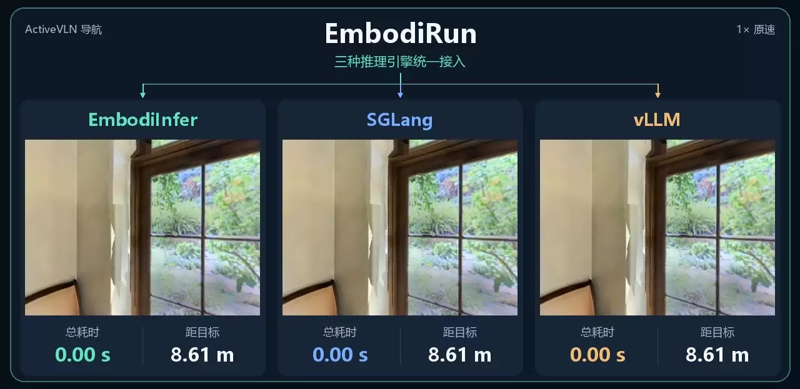
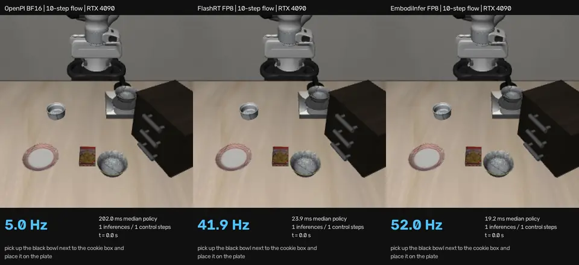
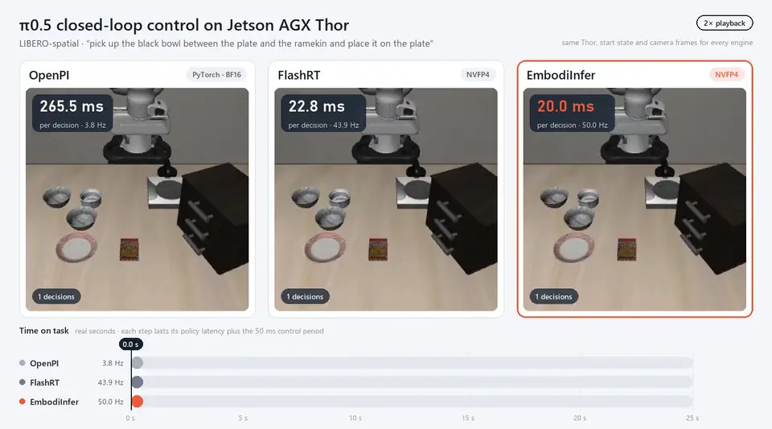
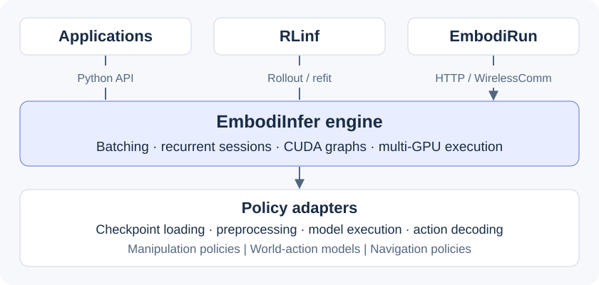

<p align="center">
  
</p>

<h3 align="center">One engine for embodied inference and RL rollout.</h3>

<p align="center">
  <a href="#demos">Demos</a> ·
  <a href="#benchmarks">Benchmarks</a> ·
  <a href="#supported-models">Supported models</a> ·
  <a href="#quick-start">Quick start</a> ·
  <a href="#deployment">Deployment &amp; Recipes</a> ·
  <a href="https://embodiinfer.readthedocs.io/">Docs</a> ·
  <a href="https://github.com/BUAA-CI-LAB/EmbodiInfer/blob/main/README.zh-CN.md">Chinese</a>
</p>

<p align="center">
  <a href="https://github.com/BUAA-CI-LAB/EmbodiInfer/blob/main/LICENSE"></a>
  <a href="https://github.com/BUAA-CI-LAB/EmbodiInfer/blob/main/pyproject.toml"></a>
</p>

**EmbodiInfer is a high-performance inference engine for embodied AI.** It accelerates VLA manipulation and VLN navigation with model-specific kernels, CUDA Graphs and hardware-aware precision.

Use **EmbodiInfer** for model execution and optimization. Use **[EmbodiRun][run]** for complete robot and simulation demos, Recipes and one-command deployment workflows.

<a id="demos"></a>

## Demos

### VLN · ActiveVLN on RTX 4090

[][vln-video]

**EmbodiInfer · SGLang · vLLM**, using the same EmbodiRun observation and execution loop. BF16, B=1, the same R2R episode and starting state, **1× playback**. This film shows single-episode task time; the inference tables below measure independent first frames. [Recording & conditions][vln-demo] · [EmbodiRun setup][vln-recipe]

### VLA · π0.5 on RTX 4090

[][pi05-4090-video]

**OpenPI BF16 · FlashRT FP8 · EmbodiInfer FP8**. LIBERO-spatial task 6 / initial state 2, 10 denoising steps, exclusive GPU use for each engine, **1× playback**.

### VLA · π0.5 on Jetson AGX Thor

[][pi05-thor-video]

**OpenPI BF16 · FlashRT NVFP4 · EmbodiInfer NVFP4**. LIBERO-spatial task 0, **2× playback**. The π0.5 timelines combine a 20 Hz control period with measured inference latency; each film shows one successful episode per engine. [Conditions & reproduction][pi05] · [EmbodiRun Recipe][so101]

<a id="performance"></a>
<a id="benchmarks"></a>

## Benchmarks

Recent engine comparisons and RLinf integration results. **Lower latency is better; speedup is baseline time / EmbodiInfer time.** Each workload has its own timing protocol.

[VLA · π0.5](#vla) | [VLN · ActiveVLN & StreamVLN](#vln) | [RLinf rollout](#rlinf)

<a id="vla"></a>

### VLA · π0.5 across inference engines

**17.06 ms on RTX 4090 — 1.29× faster than FlashRT in FP8, with all 10 denoising steps.** Same `RLinf-Pi05-LIBERO-SFT` weights, B=1, two 224×224 cameras and a 10-action chunk.

| Device | EmbodiInfer precision | EmbodiInfer | FlashRT | APXinf | Embodied.cpp | OpenPI |
|---|---|---:|---:|---:|---:|---:|
| RTX 4090 | FP8 | **17.06** | 22.06 | 40.62 (INT8) | — | — |
| RTX 4090 | BF16 | **30.08** | 31.93 (FP16) | 32.06 | 57.48 | — |
| Jetson AGX Thor | FP8 | **33.60** | 40.70 | 40.88 | — | — |
| Jetson AGX Thor | BF16 | **61.63** | 69.24 (FP16) | 67.12 | 223.97 | 261.18 |
| Jetson AGX Thor | NVFP4 | **20.04** | 21.07 | — | — | — |

Latency in **ms**, averaged over the P50s of three interleaved rounds; 200 warmup + 1,000 timed calls per round, using the FlashRT v0.2.0 harness. Thor uses MAXN and locked clocks; RTX 4090 uses default clocks. NVFP4 uses a separate interleaved run with the same settings.

Unless noted, peer cells use the row's precision. FlashRT's RTX 4090 BF16 result is **33.04 ms**; the table retains its faster FP16 result. Precision labels describe the main execution format; mixed-precision details and numerical checks are in the [report][pi05].

With the official **OpenPI `pi05_libero` checkpoint** and separate calibration and timing, RTX 4090 FP8 at 10 steps measures **17.08 ms P50 / 17.19 ms P95**. This is a separate latency evaluation, not a success-rate result. [Protocol][pi05-official]

<a id="vln"></a>

### VLN · Native inference

**RTX 4090 · BF16 · 128 independent R2R first frames.** Whole-batch **mean / P95 in ms**, measured after a full warmup pass from CPU RGB to CPU actions, including preprocessing. HTTP and simulation are excluded; SGLang includes local SRT process communication.

#### ActiveVLN — up to 3.20× over SGLang

| Batch | EmbodiInfer | SGLang SRT | vs SGLang | vLLM | vs vLLM |
|---:|---:|---:|---:|---:|---:|
| 1 | **55.39 / 57.88** | 177.22 / 218.77 | **3.20×** | 117.26 / 131.11 | **2.12×** |
| 2 | **73.60 / 77.25** | 214.48 / 252.51 | **2.91×** | 152.81 / 163.19 | **2.08×** |
| 4 | **112.02 / 113.83** | 280.95 / 319.75 | **2.51×** | 223.69 / 232.43 | **2.00×** |
| 8 | **220.13 / 290.67** | 364.19 / 407.99 | **1.65×** | 315.69 / 323.11 | **1.43×** |

#### StreamVLN — up to 3.13× over the official implementation

| Batch | EmbodiInfer | Official implementation | Speedup |
|---:|---:|---:|---:|
| 1 | **91.25 / 93.74** | 276.84 / 289.67 | **3.03×** |
| 2 | **132.20 / 138.94** | 414.05 / 432.91 | **3.13×** |
| 4 | **214.90 / 223.88** | 530.92 / 550.44 | **2.47×** |
| 8 | **381.75 / 391.61** | 768.72 / 780.07 | **2.01×** |

Recorded November 2, 2026. Each batch resets history and learned speculative candidates while retaining graphs and compiled code. The ActiveVLN B=8 first-batch spike remains included. Action outputs can differ; these are latency comparisons, not navigation success-rate measurements. [ActiveVLN report][active-bench] · [StreamVLN report][stream-bench]

<a id="rlinf"></a>

### VLN · ActiveVLN in RLinf

**2.15–2.59× faster inference calls and 1.24–1.46× faster full rollout versus SGLang.** All six measured hardware/batch configurations are shown below.

Times are **seconds per training step**; paired values read **SGLang → EmbodiInfer**. Inference totals eight batched calls, while full rollout also includes environment interaction and trajectory transfer.

| Hardware | Batch | Inference · 8 calls (s) | Speedup | Full rollout (s) | Speedup |
|---|---:|---:|---:|---:|---:|
| 2× RTX 4090 | 2 | 2.255 → **0.872** | **2.59×** | 5.001 → **3.484** | **1.44×** |
| 2× RTX 4090 | 4 | 3.148 → **1.259** | **2.50×** | 6.690 → **4.944** | **1.35×** |
| 2× RTX 4090 | 8 | 4.789 → **2.057** | **2.33×** | 10.878 → **7.987** | **1.36×** |
| 2× H20 | 2 | 1.654 → **0.639** | **2.59×** | 3.392 → **2.322** | **1.46×** |
| 2× H20 | 4 | 2.358 → **1.043** | **2.26×** | 5.292 → **3.707** | **1.43×** |
| 2× H20 | 8 | 4.125 → **1.916** | **2.15×** | 9.404 → **7.576** | **1.24×** |

BF16, `Arvil/Qwen2.5-VL-3B_rl_r2r_4000`, repeated R2R episode 1; means over five post-warmup training steps. One GPU runs actor/rollout and the other renders Habitat-Sim. These stage totals are neither single-request latency nor complete training iterations. [Configuration & results][rlinf-pr]

**Complete training iterations:** a separate 2× A800-SXM4 GRPO run using the same HF actor implementation measured **20.64 ± 0.15 s → 19.73 ± 0.41 s** when switching the rollout backend from SGLang to EmbodiInfer, with rollout phase **15.27 s → 14.77 s**. Mean ± sample SD over five iterations after discarding the first. [A800 setup & full results][a800-pr]

*RLinf integration is experimental: the upstream PR is unmerged, full HabitatLab training and convergence remain unvalidated, and the incremental/full-history logprob check has an outstanding mismatch (0.119415 vs 0.02 tolerance). See the [integration report][rlinf-report] for each experiment's validation scope.*

More models, devices and historical measurements: [full benchmark index][benchmark-index].

<a id="supported-models"></a>

## Supported models

<table>
<tr>
<th align="left" width="34%">🦾 VLA · Manipulation</th>
<th align="left" width="38%">🧭 VLN · Navigation</th>
<th align="left" width="28%">🌐 World-action</th>
</tr>
<tr>
<td valign="top">
<p>✓ <b>π0.5</b><br>✓ <b>GR00T N1.7</b><br>✓ <b>OpenVLA-OFT</b><br>✓ <b>LingBot-VLA</b><br>✓ <b>DM0.5</b></p>
</td>
<td valign="top">
<p>✓ <b>ActiveVLN</b><br>✓ <b>StreamVLN</b><br>✓ <b>Qwen R2R</b> · low / panoramic<br>✓ <b>NaViDA</b></p>
</td>
<td valign="top">
<p>✓ <b>Cosmos Policy</b></p>
</td>
</tr>
</table>

See the [model guide][models] for checkpoints, available interfaces and optimization profiles.

<a id="engine"></a>

## One engine, from inference to rollout



- **Fast model execution:** CUDA Graphs, compiled paths, fused kernels and hardware-specific precision.
- **Stateful and batched inference:** recurrent navigation sessions, context reuse, request batching and multi-GPU execution.
- **RL integration:** action sampling, log probabilities and weight refit for supported policies.

[Architecture][architecture] · [Python API][api] · [Serving][serving] · [Parallelism][parallelism]

<a id="quick-start"></a>

## Quick start

Python 3.10+ and uv 0.12.x. Run a synthetic-policy example without a checkpoint:

```bash
git clone https://github.com/BUAA-CI-LAB/EmbodiInfer.git
cd EmbodiInfer
uv sync --frozen
uv run python examples/quickstart.py
```

This synthetic-policy example demonstrates single and batched requests. For real models, follow the [installation profiles][installation], [model quick start][quickstart] and [π0.5 example][pi05-example]; benchmark reproduction uses the checkpoints and settings linked above.

<a id="deployment"></a>

## Complete demos & deployment · EmbodiRun

**[EmbodiRun][run] provides complete deployment Recipes** that connect the inference engine to robots or simulators. Prepare each Recipe's checkpoints, scene assets and hardware, then use its task entrypoint.

- **ActiveVLN / Habitat:** [Habitat setup (vLLM example)][vln-recipe] and [three-engine recording guide][vln-demo]. The packaged vLLM entrypoint awaits a GPU rerun.
- **π0.5 / SO-101:** [grasping Recipe][so101] and [backend comparison][run-comparison].
- **More robots and simulators:** [all Recipes][recipes] · [deployment coverage][run-support].

<a id="agent-optimization"></a>

## Agent-assisted optimization · In progress

An experimental workflow lets coding agents tune developer-selected operators, with whole-model numerical checks and timing. Broader automation across models and hardware is in progress. [Design & experiments][agent-workflow]

## Roadmap

- Expand optimized model and hardware coverage with reproducible benchmarks.
- Complete RLinf backend integration and training-consistency validation.
- Improve agent-assisted tuning and deployment Recipes in EmbodiRun.

Planned model adapters: **SmolVLA** and the **base OpenVLA** model. [Model roadmap][model-roadmap]

## Contributing & license

Contributions to model adapters, hardware optimizations and reproducible evaluation are welcome. [Contributing][contributing] · [Issues](https://github.com/BUAA-CI-LAB/EmbodiInfer/issues) · [Code of Conduct][conduct] · [Security][security]

Thanks to [FlashRT][flashrt], [APXinf][apxinf], [Embodied.cpp][embodied-cpp], [OpenPI][openpi], [LeRobot][lerobot], [SGLang][sglang], [vLLM][vllm] and [RLinf][rlinf-repo], alongside the upstream model, dataset and kernel authors. The π0.5 comparison uses FlashRT's v0.2.0 harness; Thor NVFP4 channel scaling draws on [SmoothQuant (ICML 2023)][smoothquant], and the tuning workflow draws on [NVIDIA KDA][kda].

Apache-2.0. [License][license] · [Notice][notice] · [Third-party notices][third-party]. Model weights and datasets retain their respective licenses.

[run]: https://github.com/BUAA-CI-LAB/EmbodiRun
[pi05]: https://github.com/BUAA-CI-LAB/EmbodiInfer/blob/5f237690fee1f55d633c2961bf2e3d3c56829f7b/docs/en/pi05-performance.md
[pi05-official]: https://github.com/BUAA-CI-LAB/EmbodiInfer/blob/5f237690fee1f55d633c2961bf2e3d3c56829f7b/docs/en/pi05-performance.md#libero-on-rtx-4090-with-openpis-checkpoint-and-evaluation
[pi05-4090-video]: https://github.com/BUAA-CI-LAB/EmbodiInfer/blob/5f237690fee1f55d633c2961bf2e3d3c56829f7b/docs/assets/pi05/libero-4090-comparison.mp4
[pi05-thor-video]: https://github.com/BUAA-CI-LAB/EmbodiInfer/blob/5f237690fee1f55d633c2961bf2e3d3c56829f7b/docs/assets/pi05/libero-thor-comparison.mp4
[vln-video]: https://github.com/BUAA-CI-LAB/misc/blob/2781315579ea1f53d95d7433de36c79ac606ee9a/embodirun/v0.1/activevln_engines/activevln_engines_1x.mp4
[vln-demo]: https://github.com/BUAA-CI-LAB/EmbodiRun/blob/4e6b392fc94c067d27594d4b65d1d9381b91cec9/docs/en/demos/activevln-engines.md
[vln-recipe]: https://github.com/BUAA-CI-LAB/EmbodiRun/tree/4e6b392fc94c067d27594d4b65d1d9381b91cec9/examples/activevln_engines
[active-bench]: https://github.com/BUAA-CI-LAB/EmbodiInfer/blob/5f237690fee1f55d633c2961bf2e3d3c56829f7b/benchmarks/activevln-benchmark/rtx-4090/README.md
[stream-bench]: https://github.com/BUAA-CI-LAB/EmbodiInfer/blob/5f237690fee1f55d633c2961bf2e3d3c56829f7b/benchmarks/streamvln-benchmark/rtx-4090/README.md
[rlinf-pr]: https://github.com/RLinf/RLinf/pull/1789
[a800-pr]: https://github.com/BUAA-CI-LAB/EmbodiInfer/pull/16
[rlinf-report]: https://github.com/BUAA-CI-LAB/EmbodiInfer/blob/5f237690fee1f55d633c2961bf2e3d3c56829f7b/docs/en/benchmark.md#activevln--rlinf-integration
[models]: https://github.com/BUAA-CI-LAB/EmbodiInfer/blob/5f237690fee1f55d633c2961bf2e3d3c56829f7b/docs/en/models.md
[architecture]: https://github.com/BUAA-CI-LAB/EmbodiInfer/blob/5f237690fee1f55d633c2961bf2e3d3c56829f7b/docs/en/architecture.md
[api]: https://github.com/BUAA-CI-LAB/EmbodiInfer/blob/5f237690fee1f55d633c2961bf2e3d3c56829f7b/docs/en/api.md
[serving]: https://github.com/BUAA-CI-LAB/EmbodiInfer/blob/5f237690fee1f55d633c2961bf2e3d3c56829f7b/docs/en/serving.md
[installation]: https://github.com/BUAA-CI-LAB/EmbodiInfer/blob/5f237690fee1f55d633c2961bf2e3d3c56829f7b/docs/en/installation.md
[quickstart]: https://github.com/BUAA-CI-LAB/EmbodiInfer/blob/5f237690fee1f55d633c2961bf2e3d3c56829f7b/docs/en/quickstart.md
[so101]: https://github.com/BUAA-CI-LAB/EmbodiRun/blob/4e6b392fc94c067d27594d4b65d1d9381b91cec9/examples/so101_grasping.md
[run-comparison]: https://github.com/BUAA-CI-LAB/EmbodiRun/blob/4e6b392fc94c067d27594d4b65d1d9381b91cec9/examples/engine_comparison/README.md
[recipes]: https://github.com/BUAA-CI-LAB/EmbodiRun/blob/4e6b392fc94c067d27594d4b65d1d9381b91cec9/examples/README.md
[run-support]: https://github.com/BUAA-CI-LAB/EmbodiRun/blob/4e6b392fc94c067d27594d4b65d1d9381b91cec9/docs/en/support-matrix.md
[agent-workflow]: https://github.com/BUAA-CI-LAB/EmbodiInfer/blob/5f237690fee1f55d633c2961bf2e3d3c56829f7b/docs/proposals/0008-kernel-tuning.md
[contributing]: https://github.com/BUAA-CI-LAB/EmbodiInfer/blob/main/CONTRIBUTING.md
[security]: https://github.com/BUAA-CI-LAB/EmbodiInfer/blob/main/SECURITY.md
[license]: https://github.com/BUAA-CI-LAB/EmbodiInfer/blob/main/LICENSE
[notice]: https://github.com/BUAA-CI-LAB/EmbodiInfer/blob/main/NOTICE
[third-party]: https://github.com/BUAA-CI-LAB/EmbodiInfer/blob/main/THIRD_PARTY_NOTICES.md
[benchmark-index]: https://github.com/BUAA-CI-LAB/EmbodiInfer/blob/main/docs/en/benchmark.md
[parallelism]: https://github.com/BUAA-CI-LAB/EmbodiInfer/blob/5f237690fee1f55d633c2961bf2e3d3c56829f7b/docs/en/parallelism.md
[pi05-example]: https://github.com/BUAA-CI-LAB/EmbodiInfer/blob/5f237690fee1f55d633c2961bf2e3d3c56829f7b/examples/pi05_inference.py
[model-roadmap]: https://github.com/BUAA-CI-LAB/EmbodiInfer/blob/5f237690fee1f55d633c2961bf2e3d3c56829f7b/docs/en/models.md#roadmap
[conduct]: https://github.com/BUAA-CI-LAB/EmbodiInfer/blob/main/CODE_OF_CONDUCT.md
[flashrt]: https://github.com/flashrt-project/FlashRT
[apxinf]: https://github.com/infinigence/ApxInf
[embodied-cpp]: https://github.com/SEU-PAISys/Embodied.cpp
[openpi]: https://github.com/Physical-Intelligence/openpi
[lerobot]: https://github.com/huggingface/lerobot
[sglang]: https://github.com/sgl-project/sglang
[vllm]: https://github.com/vllm-project/vllm
[rlinf-repo]: https://github.com/RLinf/RLinf
[smoothquant]: https://proceedings.mlr.press/v202/xiao23c.html
[kda]: https://github.com/NVlabs/kda
