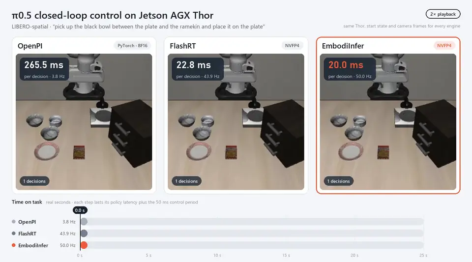
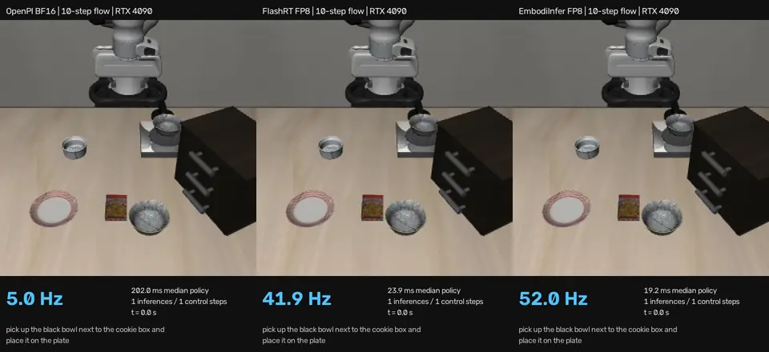
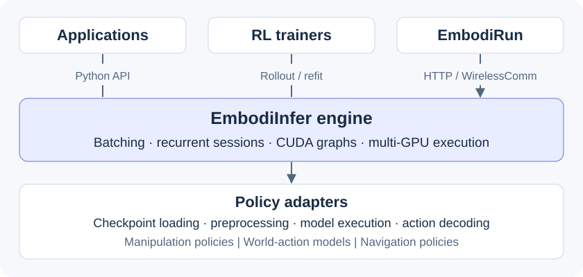

<p align="center">
  
</p>

<h3 align="center">一个引擎，统一具身推理与 RL rollout。</h3>
<p align="center">
  <a href="https://embodiinfer.readthedocs.io/zh-cn/latest/">文档</a> ·
  <a href="#快速开始">快速开始</a> ·
  <a href="#支持的模型">模型</a> ·
  <a href="#演示">演示</a> ·
  <a href="#性能">性能</a> ·
  <a href="#部署与-recipe">部署 / Recipe</a> ·
  <a href="README.md">English</a>
</p>

<p align="center">
  <a href="LICENSE"></a>
  <a href="pyproject.toml"></a>
  <a href="https://embodiinfer.readthedocs.io/"></a>
</p>

**EmbodiInfer 是面向具身模型的推理与 RL rollout 引擎。** 通过统一 Python 接口运行操作策略、世界动作模型和有状态导航策略，
结合模型专用优化与共享的批处理、会话和多 GPU 执行能力。

**从 EmbodiInfer 开始：** 查看模型、性能与 Python / 服务接口；需要连接机器人或仿真器时，
使用 [EmbodiRun](https://github.com/BUAA-CI-LAB/EmbodiRun/blob/main/README.zh-CN.md) 的一键部署案例、Recipe 与部署框架。

## 演示

### π0.5 · Jetson AGX Thor

[](benchmarks/pi05-benchmark/README.md)

OpenPI BF16、FlashRT NVFP4 与 EmbodiInfer `nvfp4-nvfp4`，LIBERO-spatial 任务 0。
**2× 播放**，画面计时为真实时间；三个引擎均完成该次任务。
[原视频与测试条件](benchmarks/pi05-benchmark/README.md)。

### π0.5 · RTX 4090

[](benchmarks/pi05-benchmark/README.md)

OpenPI BF16、FlashRT FP8 与 EmbodiInfer `fp8-fp8`，任务 6 / 初始状态 2，
均为 10 步去噪、各自独占 GPU。**1× 原速**；三个引擎均完成该次任务。
[原视频与测试条件](benchmarks/pi05-benchmark/README.md)。

## 性能

### π0.5 · Thor / RTX 4090 多引擎对比

| 设备 | 精度档 | EmbodiInfer 预设 | EmbodiInfer | FlashRT | APXinf | Embodied.cpp | OpenPI |
|---|---|---|---:|---:|---:|---:|---:|
| Jetson AGX Thor | FP4 | `nvfp4-nvfp4` | **20.04**（49.9 Hz） | 21.07 | — | — | — |
| Jetson AGX Thor | FP8 | `fp8-fp8` | **33.60**（29.8 Hz） | 40.70 | 40.88 | — | — |
| Jetson AGX Thor | 16 位 | `bf16` | **61.63**（16.2 Hz） | 69.24（FP16） | 67.12 | 223.97 | 261.18 |
| RTX 4090 | 8 位 | `fp8-fp8` | **17.06**（58.6 Hz） | 22.06 | 40.62（INT8） | — | — |
| RTX 4090 | 16 位 | `bf16` | **30.08**（33.2 Hz） | 31.93（FP16） | 32.06 | 57.48 | — |

单位 **ms**，括号内为 EmbodiInfer 的推理频率。使用 FlashRT v0.2.0 的
`examples/thor/pi05.py`，同一 `RLinf-Pi05-LIBERO-SFT` 权重、
B=1、双路 224×224 相机、10 步去噪、动作长度 10。
每轮预热 200 次、计时 1,000 次，取 **3 轮交替运行的 P50 平均值**；
Thor FP4 为另一次同设置的交替运行。Thor 使用 MAXN 并锁频，4090 使用默认频率。
[完整配置与复现](benchmarks/pi05-benchmark/README.md)。

### π0.5 · RTX 4090 LIBERO-spatial 官方评测

| 配置 | 去噪步数 | 成功率 | 延迟 P50 | 频率 |
|---|---|---:|---:|---:|
| OpenPI · PyTorch BF16 | 10 | 494/500 · 98.8% | — | — |
| **EmbodiInfer · `fp8-fp8`** | **2，ρ = 3** | **495/500 · 99.0%** | **13.34 ms** | **75.0 Hz** |
| EmbodiInfer · `fp8-fp8` | 3，ρ = 1 | 495/500 · 99.0% | 13.79 ms | 72.5 Hz |
| EmbodiInfer · `fp8-fp8` | 2，ρ = 1 | 491/500 · 98.2% | 13.33 ms | 75.0 Hz |
| EmbodiInfer · `fp8-fp8` | 3，ρ = 2 | 490/500 · 98.0% | 13.80 ms | 72.5 Hz |
| EmbodiInfer · `fp8-fp8` | 4，ρ = 1 | 489/500 · 97.8% | 14.21 ms | 70.4 Hz |

使用 OpenPI 官方 `pi05_libero` 权重与未修改的官方评测入口，
**10 个任务 × 50 次，共 500 次**，每次执行动作块的前 5 步。
ρ 为 flow 时间网格参数；少步配置沿用训练好的权重。
本表使用该权重自己的 FP8 标定，与上表的 RLinf 权重分开记录；
延迟由空闲 GPU 上的 `libero/latency.py` 测得，上面的录像均为 10 步去噪。
[评测、标定与完整结果](benchmarks/pi05-benchmark/README.md)。

Thor NVFP4 的通道缩放借鉴 [SmoothQuant](https://proceedings.mlr.press/v202/xiao23c.html)；
30 次任务 0 评测成功 25/30，FlashRT NVFP4 为 26/30。
[Thor 校准与评测](docs/zh/pi05-performance.md)。

## 支持的模型

✓ 已实现 · ◐ 实验性 · ○ 计划支持；具体检查点与验证范围见[模型参考](docs/zh/models.md)。

| 类别 | 模型 | Python 推理 | HTTP / WirelessComm | 能力与限制 |
|---|---|---|---|---|
| VLA | π0.5 | ✓ | ✓ | 跨会话批处理；BF16 / 设备专用量化预设；RL decoder。 |
| VLA | GR00T N1.7 | ✓ | — | 批处理与 RL decoder；使用基准专用环境。 |
| VLA | OpenVLA-OFT | ✓ | — | 单次 forward 动作解码与 RL decoder。 |
| VLA | LingBot-VLA | ✓ | — | Flow matching 与 RL decoder。 |
| VLA | DM0.5 | ✓ | ✓ | 需独立 OpenDM 环境；网络服务保持 B=1。 |
| VLN | StreamVLN | ✓ | ✓ | 循环历史；专用张量批处理；通用网络服务保持 B=1。 |
| VLN | Qwen R2R low / panoramic · NaViDA | ✓ | — | 显式循环会话与策略专用解码。 |
| VLN | ActiveVLN | ◐ | — | 专用循环 / 张量批处理 API；通用服务适配仍待合入，真实权重 GPU parity 待完成。 |
| 世界动作 | Cosmos Policy | ✓ | — | 扩散动作生成与候选规划；不提供通用 RL decoder。 |
| 计划 | SmolVLA · OpenVLA 基础模型 | ○ | ○ | 模型适配、输入处理与服务接入待实现。 |

`—` 表示无通用网络适配器；部署案例的专用服务不等同于通用服务支持。
[完整能力、依赖与安装矩阵](docs/zh/models.md#capabilities-and-installation) ·
[模型路线图](docs/zh/models.md#roadmap)。

## 快速开始

### 无需权重的首次运行

使用 Python 3.10+ 和 [uv](https://docs.astral.sh/uv/) 0.12.x：

```bash
git clone https://github.com/BUAA-CI-LAB/EmbodiInfer.git
cd EmbodiInfer
uv sync --frozen
uv run python examples/quickstart.py
```

示例可在 CPU 上运行，使用合成策略演示单条和批量请求，并打印动作形状，无需下载模型权重。
Linux lock 包含 CUDA 版 Torch，CPU 主机的安装下载量也可能较大。

### 加载 π0.5

使用 CUDA GPU 和 π0.5 专用 profile：

```bash
uv sync --python 3.12 --frozen --no-dev --group pi05
uv run --no-sync python examples/pi05_inference.py \
  --ckpt lerobot/pi05_base --envs 1
```

该示例加载真实权重，但输入仍为合成观测，用来演示引擎 API。
真实图像与状态接入见[服务教程](docs/zh/serving.md#send-your-first-observation)。

### 选择接入方式

| 用途 | 接口 | 入口 |
|---|---|---|
| 在应用内推理 | `EmbodiInfer.act(observation)` 或 `EmbodiInfer.act(observations)` | [Python API](docs/zh/api.md) |
| 为机器人运行时提供网络推理 | HTTP / WirelessComm 会话 | [服务与首次观测请求](docs/zh/serving.md) |
| RL rollout 与权重更新 | Rollout / refit 接口 | [RL 集成](docs/zh/api.md#generating-rl-rollouts) |
| 多 GPU 执行 | 数据并行 / 张量并行 | [并行指南](docs/zh/parallelism.md) |

多个客户端共享 π0.5 服务时，为 HTTP 或 WirelessComm 启动器添加
`--max-batch 3 --max-wait-ms 5`。独立会话的请求可组成最多三个请求的批次；
5 ms 收集窗口结束时，未满批次也会执行。该窗口不包括排队和推理时间。
配置步骤见[服务指南](docs/zh/serving.md#多客户端批处理-share-one-service-across-clients)。

发行包名为 `embodiinfer`；Python import、`embodiinfer-*` 命令行入口与 `embodiinfer.policy.*` 通信 schema 统一使用同一命名。

## 部署与 Recipe

[EmbodiRun](https://github.com/BUAA-CI-LAB/EmbodiRun/blob/main/README.zh-CN.md) 提供一键案例入口与部署框架。
按 Recipe 准备检查点、场景或硬件后，使用统一的 `embodirun example` 命令完成配置、检查、启动与停止。

| 场景 | 部署入口 | 当前状态 |
|---|---|---|
| VLA · SO-101 / π0.5 | [抓取 Recipe](https://github.com/BUAA-CI-LAB/EmbodiRun/blob/main/examples/so101_grasping.md) · [多后端对比](https://github.com/BUAA-CI-LAB/EmbodiRun/blob/main/examples/engine_comparison/README.md) | 已有真机录像；按检查点与硬件配置。 |
| VLN · MicroDuck / MuJoCo | [导航 Recipe](https://github.com/BUAA-CI-LAB/EmbodiRun/blob/main/examples/microduck_vln/README.md) | 专用仿真 Recipe，需准备场景、模型与 GPU。 |
| VLN · Habitat / 三引擎 | [录像与配置](https://github.com/BUAA-CI-LAB/EmbodiRun/blob/main/docs/zh/demos/activevln-engines.md) | 实验性；可复用 vLLM 封装入口的 GPU 验证待完成。 |
| VLN · Go2 / ActiveVLN | [真机演示](https://github.com/BUAA-CI-LAB/EmbodiRun/blob/main/docs/zh/demos/go2-activevln.md) | 已有录像；适配实现仍在 [Run #13](https://github.com/BUAA-CI-LAB/EmbodiRun/pull/13)。 |
| Agent · XLeRobot | [移动抓取 Recipe](https://github.com/BUAA-CI-LAB/EmbodiRun/blob/main/examples/xlerobot_snack_delivery/README.md) | 软件演练与监督下硬件流程。 |

[完整覆盖矩阵与路线图](https://github.com/BUAA-CI-LAB/EmbodiRun/blob/main/docs/zh/support-matrix.md) ·
[全部 Recipe](https://github.com/BUAA-CI-LAB/EmbodiRun/blob/main/examples/README.md)。

## 为什么选择 EmbodiInfer？



优化模型执行路径，让机器人推理与 RL rollout 共用一套引擎。

<table>
<tr>
<td width="50%" valign="top">
<h3>⚡ 捕获、编译、回放</h3>
<p><b>CUDA Graphs · torch.compile / Inductor</b></p>
<p>回放静态 prefix 和解码路径，编译模型计算。针对不同策略配置执行路径，优化去噪与 token 生成中的重复计算。</p>
<a href="docs/zh/architecture.md#cuda-graph-capture">执行路径 →</a>
</td>
<td width="50%" valign="top">
<h3>🎚️ 为 GPU 选择合适精度</h3>
<p><b>BF16 · FP8 · INT8 · NVFP4</b></p>
<p>π0.5 与 StreamVLN 提供硬件专用配置：AGX Orin 使用 INT8，RTX 4090 与 Thor 使用 FP8，Thor 还提供 NVFP4。</p>
<a href="docs/zh/models.md#optimization-profiles">精度与后端配置 →</a>
</td>
</tr>
<tr>
<td valign="top">
<h3>🔥 深入算子的原生优化</h3>
<p><b>Triton attention · 模型算子融合</b></p>
<p>专用 attention kernel，以及融合的归一化、旋转位置编码和门控激活，为受支持的原生模型路径加速。</p>
<a href="docs/zh/models.md#optimization-profiles">原生优化 →</a>
</td>
<td valign="top">
<h3>🧠 复用上下文，保留历史</h3>
<p><b>Prefix KV 复用 · 有状态会话</b></p>
<p>多步去噪复用固定观测上下文；导航策略保留 episode 历史，通过事务更新状态，并支持显式重置和取消。</p>
<a href="docs/zh/architecture.md#sessionstore">上下文与会话管理 →</a>
</td>
</tr>
<tr>
<td valign="top">
<h3>🚀 从单次请求到多环境并行</h3>
<p><b>请求批处理 · 多 GPU 执行</b></p>
<p>批量提交观测、聚合异步请求，或将任务分发到多个模型副本。受支持的策略还提供张量并行。</p>
<a href="docs/zh/parallelism.md">并行执行 →</a>
</td>
<td valign="top">
<h3>🔄 融入 RL 训练循环</h3>
<p><b>动作采样 · log probability · 权重更新</b></p>
<p>通过支持 RL 的 decoder 收集 rollout、更新策略权重。保留自己的训练器与学习目标，复用模型执行能力。</p>
<a href="docs/zh/api.md#generating-rl-rollouts">RL 集成 →</a>
</td>
</tr>
</table>

根据策略与硬件在[能力参考](docs/zh/models.md#capabilities-and-installation)中选择配置。
适配器负责模型专用优化，共享调度器保持模型无关。

**Agent 调优 kernel：** [π0.5 开发者工作流](docs/proposals/0008-kernel-tuning.md)支持算子捕获、校准与调优，设计借鉴 [NVIDIA KDA](https://github.com/NVlabs/kda)。面向用户的自动硬件 / 环境调优仍在规划中。

## 文档

| 内容 | 指南 |
|---|---|
| 安装模型环境 | [安装](docs/zh/installation.md) |
| 运行推理 | [快速开始](docs/zh/quickstart.md) · [示例](examples/) |
| 部署服务 | [服务](docs/zh/serving.md) |
| 使用多张 GPU | [并行](docs/zh/parallelism.md) |
| 集成或扩展引擎 | [架构](docs/zh/architecture.md) · [Python API](docs/zh/api.md) |
| 了解模型能力 | [模型](docs/zh/models.md) |
| 评估性能 | [基准](docs/zh/benchmark.md) |

### 路线图

| 方向 | 状态与后续工作 |
|---|---|
| 原生推理与设备预设 | π0.5 Thor / 4090 与 LIBERO 评测已合入；其他模型与平台按基准逐项扩展。 |
| ActiveVLN 通用服务 | [#19](https://github.com/BUAA-CI-LAB/EmbodiInfer/pull/19) / [#20](https://github.com/BUAA-CI-LAB/EmbodiInfer/pull/20) 仍为 Draft，通用服务待合入；专用 API 与录像可查阅。 |
| 新模型 | SmolVLA、OpenVLA 基础模型的适配与数值验证。 |
| Agent 算子调优 | 已有 π0.5 开发者工作流；面向用户的自动硬件 / 环境调优待实现。 |
| 部署案例 | 在 EmbodiRun 完善 Go2 等 Recipe、独立部署验证与扩展性测量。 |

## 参与贡献

开发流程、模型接入与数值验证要求见 [CONTRIBUTING.md](CONTRIBUTING.md)。
问题与建议请提交 [GitHub issue](https://github.com/BUAA-CI-LAB/EmbodiInfer/issues)，
漏洞请按 [SECURITY.md](SECURITY.md) 私下报告。社区遵循[行为准则](CODE_OF_CONDUCT.md)。

## 致谢与引用

- **量化方法：** 感谢 Guangxuan Xiao 等人的
  [SmoothQuant（ICML 2023）](https://proceedings.mlr.press/v202/xiao23c.html) 与
  [开源实现](https://github.com/mit-han-lab/smoothquant)。Thor NVFP4 校准借鉴其通道缩放方法，
  并结合本项目的 NVFP4 打包与 BF16 离群通道旁路；[实现与测量](docs/zh/pi05-performance.md)分别说明。
- **基准与参考引擎：** 感谢 [FlashRT](https://github.com/flashrt-project/FlashRT)
  提供开源 VLA 推理与 PI0.5 测速流程；本项目多引擎表使用其 v0.2.0 harness。
  感谢 [APXinf](https://github.com/infinigence/ApxInf)、
  [Embodied.cpp](https://github.com/SEU-PAISys/Embodied.cpp)、
  [OpenPI](https://github.com/Physical-Intelligence/openpi)、
  [LeRobot](https://github.com/huggingface/lerobot)、
  [SGLang](https://github.com/sgl-project/sglang) 与 [vLLM](https://github.com/vllm-project/vllm)
  提供模型参考与对照实现。
- **模型、数据与算子生态：** 感谢上游模型作者、
  [LIBERO](https://github.com/Lifelong-Robot-Learning/LIBERO)、
  [Habitat](https://github.com/facebookresearch/habitat-lab)、
  [RLinf](https://github.com/RLinf/RLinf)、
  [PyTorch](https://github.com/pytorch/pytorch)、[Triton](https://github.com/triton-lang/triton)、
  [CUTLASS](https://github.com/NVIDIA/cutlass)、
  [FlashAttention](https://github.com/Dao-AILab/flash-attention)、
  [FlashInfer](https://github.com/flashinfer-ai/flashinfer) 与
  [NVIDIA KDA](https://github.com/NVlabs/kda)。

各项目具体用途、派生代码与许可证归属见[第三方声明](THIRD_PARTY_NOTICES.md)；
性能比较对应表中固定版本与配置。

## 许可证

Apache-2.0。参见 [LICENSE](LICENSE)、[NOTICE](NOTICE) 和[第三方声明](THIRD_PARTY_NOTICES.md)。
权重和数据集保留上游许可证。
