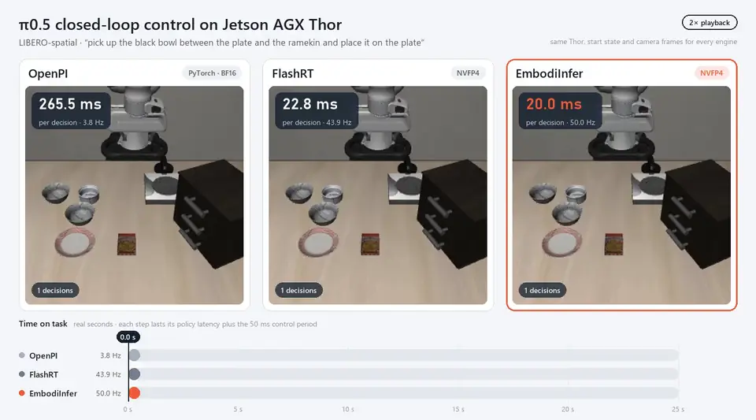

# PI0.5 Benchmark

PI0.5 的推理性能与数值核验结果。

## Jetson AGX Thor 与 RTX 4090（2026-11）

所有引擎都运行 FlashRT v0.2.0 自带的 PI0.5 基准脚本 `examples/thor/pi05.py`，只替换模型加载和每次调用：同一份 `RLinf-Pi05-LIBERO-SFT` 权重，FlashRT `pi05_libero.npz` 的 8 个 LIBERO 观测轮流输入，13 token prompt，B=1、2 路 224×224 相机、10 步去噪、动作长度 10。每轮预热 200 次、计时 1,000 次并取 P50，同一设备上的各引擎交替运行 3 轮，表中为 3 轮 P50 的平均（ms）。Thor 为 MAXN 模式，GPU / 内存 / CPU 频率锁定在 1575 MHz / 4266 MHz / 2.6 GHz；RTX 4090 为默认频率。

| 设备 | 精度档 | EmbodiInfer 预设 | EmbodiInfer | FlashRT | APXinf | Embodied.cpp | OpenPI |
|---|---|---|---:|---:|---:|---:|---:|
| Jetson AGX Thor | FP4 | `nvfp4-nvfp4` | **20.04**（49.9 Hz） | 21.07 | — | — | — |
| Jetson AGX Thor | FP8 | `fp8-fp8` | **33.60**（29.8 Hz） | 40.70 | 40.88 | — | — |
| Jetson AGX Thor | 16 位 | `bf16` | **61.63**（16.2 Hz） | 69.24（FP16） | 67.12 | 223.97 | 261.18 |
| RTX 4090 | 8 位 | `fp8-fp8` | **17.06**（58.6 Hz） | 22.06 | 40.62（INT8） | — | — |
| RTX 4090 | 16 位 | `bf16` | **30.08**（33.2 Hz） | 31.93（FP16） | 32.06 | 57.48 | — |

Thor 的两个 FP4 引擎在另一次交替运行中测得，同样 3 轮、同一套设置。Thor 上 8 次固定种子调用的动作与 OpenPI 参考的余弦相似度（平均 / 最差）：`nvfp4-nvfp4` 0.997182 / 0.995833，`fp8-fp8` 0.999785 / 0.999716，`bf16` 0.999995 / 0.999993。RTX 4090 的 `bf16` 与 `fp8-fp8` 在 RLinf LIBERO 验证集（10 个观测 × 5 个噪声种子）上与 strict BF16 预设的动作余弦相似度为 0.999997 与 0.99996。

Thor 上 LIBERO-spatial 任务 0 的闭环：同一初始状态和输入帧，每个控制步重新决策，控制周期 50 ms，三个引擎都完成任务。

| 引擎 | 决策次数 | 策略延迟 P50（ms） | 频率 | 完成用时 |
|---|---:|---:|---:|---:|
| OpenPI · PyTorch BF16 | 74 | 265.52 | 3.8 Hz | 23.68 s |
| FlashRT · NVFP4 | 71 | 22.79 | 43.9 Hz | 5.17 s |
| **EmbodiInfer · `nvfp4-nvfp4`** | 68 | 20.00 | 50.0 Hz | 4.76 s |



2 倍速播放，画面中的计时为真实时间；原视频见 [libero-thor-comparison.mp4](../../docs/assets/pi05/libero-thor-comparison.mp4)。

Thor 的 `nvfp4-nvfp4` 校准对两个塔的 gate/up 做 SmoothQuant 后再打包 NVFP4，并让 prefix 第 16 层 down 投影的 128 个离群通道走 BF16 旁路（说明见[性能文档](../../docs/zh/pi05-performance.md#thor-上的-nvfp4-校准)）。同一任务初始状态 0–29 各一局：

| 引擎 · 配置 | 成功 | 2 秒后碗仍在盘上 | 碗与盘中心距离 |
|---|---:|---:|---:|
| EmbodiInfer · `nvfp4-nvfp4`，就近舍入打包 | 18/30 | 10/30 | 2.45 cm |
| **EmbodiInfer · `nvfp4-nvfp4`** | **25/30** | **21/30** | **1.85 cm** |
| FlashRT · NVFP4 | 26/30 | 24/30 | 1.91 cm |

各引擎的版本、配置与加速比见 [PI0.5：Thor 与 RTX 4090 性能对比](../../docs/zh/pi05-performance.md)。部署时直接选择设备和预设，预设名按 prefix MLP、action MLP 的精度排列，配置说明见[模型文档](../../docs/en/models.md#opt-in-fused-operators)：

```python
make_policy("pi05", checkpoint="/models/RLinf-Pi05-LIBERO-SFT", device_type="thor", preset="nvfp4-nvfp4")
```

## RTX 4090 上的 LIBERO 官方评测（2026-11）

OpenPI 官方 `pi05_libero` 权重（转为 PyTorch）配合官方 `examples/libero/main.py`（不做修改），LIBERO-spatial
10 个任务 × 50 次，每次推理执行动作块的前 5 步。EmbodiInfer 使用 `fp8-fp8` 预设和这份权重自己的 FP8 标定；
少步配置沿用训练好的权重，只把去噪步放在幂次网格 t<sub>i</sub> = (1 − i/N)<sup>ρ</sup> 上
（`Pi05Policy.flow_schedule_rho`，ρ = 1 即均匀网格）。

| 配置 | 去噪步数 | 成功率 | 延迟 P50 | 频率 |
|---|---|---:|---:|---:|
| OpenPI · PyTorch BF16 | 10 | 494/500 · 98.8% | — | — |
| **EmbodiInfer · `fp8-fp8`** | **2，ρ = 3** | **495/500 · 99.0%** | **13.34 ms** | **75.0 Hz** |
| EmbodiInfer · `fp8-fp8` | 3，ρ = 1 | 495/500 · 99.0% | 13.79 ms | 72.5 Hz |
| EmbodiInfer · `fp8-fp8` | 2，ρ = 1 | 491/500 · 98.2% | 13.33 ms | 75.0 Hz |
| EmbodiInfer · `fp8-fp8` | 3，ρ = 2 | 490/500 · 98.0% | 13.80 ms | 72.5 Hz |
| EmbodiInfer · `fp8-fp8` | 4，ρ = 1 | 489/500 · 97.8% | 14.21 ms | 70.4 Hz |

延迟由 `libero/latency.py` 在空闲 GPU 上测得；同条件下 EmbodiInfer 10 步为 17.08 ms（58.5 Hz），OpenPI 在闭环中
每次推理约 200 ms。各引擎同一 episode 的对比视频、标定细节和计时口径见
[PI0.5 性能页](../../docs/zh/pi05-performance.md)。

`libero/` 中的 `serve.py`、`calibrate.py`、`latency.py` 在 EmbodiInfer 环境中运行（另需 OpenPI 的
`packages/openpi-client`），`observations.py`、`film.py` 在 OpenPI 的 LIBERO 客户端环境中运行。转换后的
权重目录需带上原权重的 `assets/`；`--tokenizer` 指向 PaliGemma 的 `tokenizer.model`。

```bash
# 在 OpenPI 仓库中转换官方权重
python examples/convert_jax_model_to_pytorch.py --checkpoint-dir /ckpt/pi05_libero \
  --config-name pi05_libero --output-path /ckpt/pi05_libero_pytorch
cp -r /ckpt/pi05_libero/assets /ckpt/pi05_libero_pytorch/

# FP8 标定：录制 LIBERO 观测，记录各层激活范围
python libero/observations.py --out runs/libero/observations.npz
python libero/calibrate.py --checkpoint /ckpt/pi05_libero_pytorch --tokenizer /models/paligemma/tokenizer.model \
  --observations runs/libero/observations.npz --out runs/libero/calibration.json

# 推理服务：每个配置 NAME:STEPS:RHO:PORT 一个端口；再在 OpenPI 仓库中运行官方评测
python libero/serve.py --checkpoint /ckpt/pi05_libero_pytorch --tokenizer /models/paligemma/tokenizer.model \
  --calibration runs/libero/calibration.json --serve s2_rho3:2:3:8000 s10:10:1:8001
python examples/libero/main.py --args.port 8000

# 延迟与视频
python libero/latency.py --checkpoint /ckpt/pi05_libero_pytorch --tokenizer /models/paligemma/tokenizer.model \
  --calibration runs/libero/calibration.json --observations runs/libero/observations.npz --out runs/libero/latency.json
python libero/film.py --port 8000 --tasks 6 --inits 2 --label "EmbodiInfer FP8 | 2-step flow, rho=3" \
  --out-dir runs/libero/films/s2_rho3
python libero/stack.py runs/libero/films/*/task6_init2.mp4 -o runs/libero/compare.mp4
```

## 其他平台与早期结果

各平台此前测得的结果汇总。权重、输入和计时范围逐行不同，只在行内对照，不与上表换算。

| 平台 | 工作负载与计时 | EmbodiInfer | 对照 |
|---|---|---|---|
| DGX Spark | `RLinf-Pi05-LIBERO-SFT`，B=1、H=10，同步 wall P50 | NVFP4 prefix + FP8 action **65.76 ms**，完整优化 BF16 81.31 ms | 原 EmbodiInfer BF16 109.33 ms（加速 1.66× / 1.34×） |
| Jetson Orin NX | `RLinf-Pi05-LIBERO-SFT`，B=1、H=10，同步 wall | `w8a8-w4a16` **321.9–338.3 ms**，`w4a16` 395.5–405.1 ms | — |
| AGX Orin 32GB | 三相机 `pi05-chips-30000`，B=1、输出 50×12，P50 | eager + 完整去噪图 **2311.7 ms**，动作与 LeRobot 逐位一致 | LeRobot 2751.8 ms（1.19×） |
| AGX Orin | `RLinf-Pi05-LIBERO-SFT`，LeRobot 数值语义，H=10，FP32 GEMM 允许 TF32，GPU elapsed 均值 | BF16 363.41 ms | — |
| RTX 4090 | LIBERO-10 1,600 帧离线回放，B=1，E2E 均值 | 原生优化 **38.89 ms**（25.71 obs/s） | 原 EmbodiInfer 74.33 ms，PhyAI 41.31 ms，vla.cpp 79.36 ms，Embodied.cpp 89.99 ms |
| Jetson AGX Thor | LIBERO-10 1,600 帧离线回放，B=1，E2E 均值，原生优化之前 | 164.05 ms | — |

RTX 4090 上默认关闭的 `prefix_gelu_fusion` 另有约 1.3% 的完整请求收益，动作逐字节不变。

## 数据与计时口径

1,600 帧离线回放使用 LeRobot `pi05_libero_finetuned_v044` 检查点及其 tokenizer、状态归一化和动作反归一化。数据为 [LIBERO-datasets](https://huggingface.co/datasets/yifengzhu-hf/LIBERO-datasets) revision `f13aa24a3da8c43c7225569f28c562979fa0e35a` 的 `libero_10/*.hdf5`：任务文件名字典序取 10 个，每任务按 numeric demo ID 取前 10 段，每段含首尾均匀取 16 帧，共 1,600 帧。输入 agentview、wrist RGB、EEF position3 + axis-angle3 + gripper2 及任务指令，10 个去噪步，每次输出 50×7 动作块。

统一单卡、B=1、BF16、seed=42，预热 10 次，正式测量 1 遍。计时从已解码的 CPU RGB/状态开始，到 CPU 输出结束，包含预处理、模型执行、后处理及两端 CUDA 同步；磁盘读取/解码、模型加载和预热（含编译与图捕获）不计入。不运行仿真，不计算任务成功率。

## 运行

在本目录执行。`setup_env.py` 为本目录创建独立 `.venv`，`benchmark.py` 自带数据采样和计时；`--platform` 可选 `thor` 或 `4090`，模型依赖分别见 `requirements-thor.txt` / `requirements-4090.txt`，模型与数据路径在 `config.yaml` 中设置，结果默认写入 `runs/`。

```bash
CUDA_VISIBLE_DEVICES=0 python3 setup_env.py --platform thor --runtime-python /path/to/verified-runtime/bin/python --inference-root /path/to/EmbodiInfer
CUDA_VISIBLE_DEVICES=0 .venv/bin/python benchmark.py --validate-data
CUDA_VISIBLE_DEVICES=0 .venv/bin/python benchmark.py
```

Transformers 5 的 GemmaTokenizer 需要包含完整词表的 `tokenizer.json`，只有 `tokenizer.model` 时可能静默加载成 5-token 词表。首次运行前用 `prepare_tokenizer.py` 生成并核验：

```bash
.venv/bin/python prepare_tokenizer.py --tokenizer-dir /path/to/paligemma-tokenizer --dataset-root /path/to/libero_10 --output runs/tokenizer-validation.json
```

其他脚本：

| 脚本 | 用途 |
|---|---|
| `compare.py`、`throughput.py` | 冻结数值门槛下的竞品 / 原生优化对比，以及 batch 吞吐 |
| `compare_optimizations.py` | 独立源码、独立进程的原 BF16 与优化配置对照 |
| `validate_optimizations.py` | 三平台 LeRobot profile 的数值核验与计时 |
| `validate_nonquant.py`、`ablate_nonquant.py` | 非量化可选项的逐层精度验收与消融计时 |
| `compare_recorded.py` | 本地录制观测的逐位对照与计时 |
| `libero/serve.py` | 以 OpenPI websocket 协议提供 EmbodiInfer（多个步数 / ρ 配置共享权重）或 FlashRT 推理服务，供官方 LIBERO 客户端评测 |
| `libero/observations.py`、`libero/calibrate.py` | 录制 LIBERO 观测；为 OpenPI 权重生成绑定 SHA256 的 FP8 激活范围 |
| `libero/latency.py` | 各步数 / ρ 配置的单次推理延迟 |
| `libero/film.py`、`libero/stack.py` | 按官方协议录制带推理频率的 LIBERO 视频，并横向或顺序拼接 |
| `prepare_cpp.py` | vla.cpp / Embodied.cpp 的权重转换；Embodied.cpp 另需[常量存储补丁](embodied-pi05-constants.patch) |
